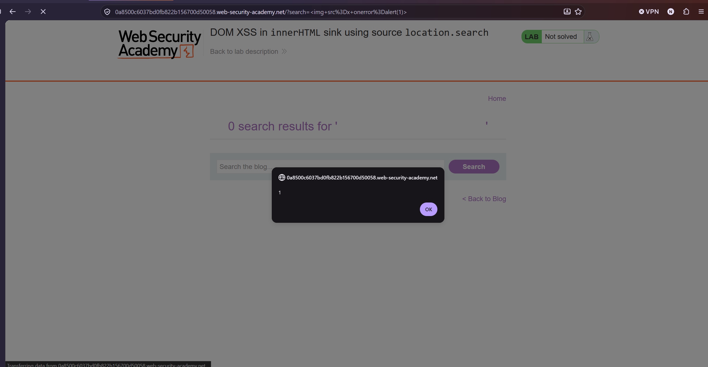
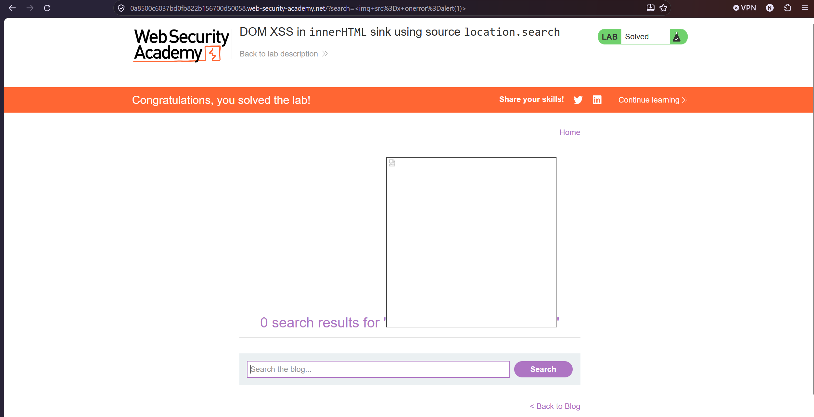

Lab: DOM XSS in innerHTML sink using source location.search

to solve this lab we use payload we use payload  and
This DOM XSS vulnerability happens because the innerHTML sink parses your input string as active HTML code, and the  payload bypasses the browser's built-in defenses that block standard <script> tags when using innerHTML. [1] 

and finnaly the Lab is solved

