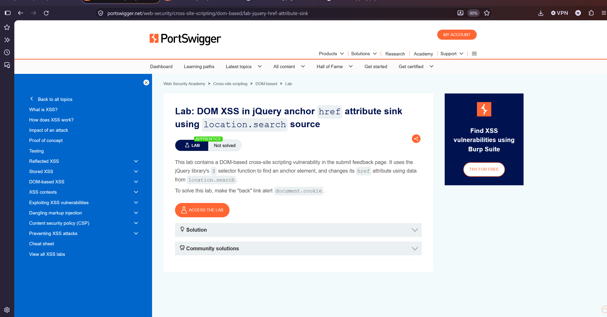

Lab: DOM XSS in jQuery anchor href attribute sink using location.search source

The vulnerability in this Lab triggers the moment the user clicks the "Back" button. Because the application does not sanitize the input, the browser mistakes the text for legitimate system code and executes javascript:alert(document.cookie), which fulfills the specific requirement to solve the lab.

To solve This Lab we add the payload  javascript:alert(document.cookie) in the returnPath=/ change the / to payload  javascript:alert(document.cookie)

